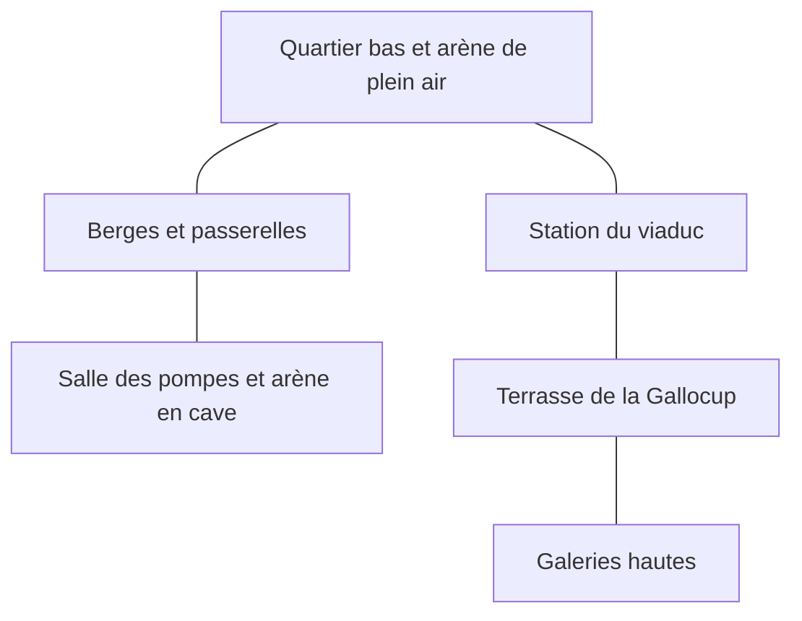

# Ergot · La ville du canal aux hauteurs

*Deuxième essai, consacré aux infrastructures et aux usages technologiques.*

Les gallodromes donnent le ton de la ville. La taille du ring se comprend par les gens accoudés au bord, et un regard depuis les gradins raconte autant que la charpente. On découvre le quartier de la même manière, depuis un seuil, en remontant les marches de la station ou à hauteur d’eau sous le pont.

## Relief proposé

Le viaduc traverse le bassin. L’arène de plein air prend place parmi les toits bas, près de la cantine et des ateliers. La salle des pompes offre un raccord vers l’arène de la cave. Plus haut, la station dessert la terrasse de la Gallocup, puis les galeries couvertes donnent sur le canal.

## Les équipements dans la ville

L’eau potable circule dans un réseau fermé qui longe les quais et remonte vers les rues. Des bandes vert pâle identifient les conduites principales. L’accès à l’eau est payant jusque dans les cours populaires. Dans cet essai, le paiement au litre se comprend avec trois éléments visibles ensemble, le lecteur de carte, le bec et le bidon.

À la station, une caméra fixe est orientée vers les marches. Un drone de sécurité quitte un dock relié au bâtiment et survole les passages. Les autres caméras se lisent par leur orientation et leur support, sous une poutre en ville ou dans une voûte des hauteurs.

L’entretien des sols est automatisé, avec une balayeuse sur la place basse et une autolaveuse dans la galerie. Un quartier précaire a lui aussi des machines. Les ateliers remettent leurs pièces en circulation, et les équipements se greffent sur des murs déjà repris. L’écart entre le bas et les hauteurs se lit dans l’état du bâti et le confort des circulations.

## Les huit vues de la ville

Les images sont dans le dossier `Ville/` de l’archive.

| Illustration | Repère pour la carte |
| --- | --- |
| `01_Panorama.png` | Suivre le réseau d’eau le long des quais et derrière les toits. Le viaduc, la station et la rotonde restent les repères d’orientation. |
| `02_Cour_porte_verte.png` | Placer la fontaine payante contre le mur. Laisser la place de poser un bidon et vérifier le trajet devant le seuil vert avec le personnage. |
| `03_Rue_des_recuperateurs.png` | Montrer la réparation à hauteur d’établi, avec le robot ouvert, le casier à batteries et le bras récupéré. Garder lisible la ruelle qui tourne vers la berge. |
| `04_Cantine.png` | Garder le service du bol au premier plan. Dans le kiosque, un doseur relié à la cuve verse le bouillon au-dessus d’une balance. |
| `05_Canal_et_pompes.png` | Faire lire le quai, les marches et l’eau à des niveaux distincts. Les conduites sur supports passent au-dessus des grilles. Un petit robot inspecte la ligne. |
| `06_Station_du_viaduc.png` | Relier l’escalier, l’ascenseur et la place basse. Le dock et la caméra se fixent au poteau du quai. La balayeuse circule sur la place. |
| `07_Galerie_haute.png` | Le vitrage cadre le quartier bas. Le passage du robot se voit sur les dalles humides, à côté des bancs et des portes abritées. |
| `08_Ecurie.png` | Conserver la place des soins dans l’allée. Le doseur de grain, la conduite d’abreuvement et le socle des bagues d’activité s’ajoutent au mobilier existant. |

Le dossier `Gallodromes/` réunit les cinq repères de départ, du plein air de jour et de nuit à la cave et à la Gallocup.

## Passage en carte

Transposer les masses et les parcours dans la vue 2D top-down du prototype. Vérifier le passage du personnage devant la porte verte, au pied des bornes et sur les paliers. Les conduites longent les murs, avec des raccords visibles là où une branche dessert un lieu. Sous les arches et les auvents, vérifier les masques de premier plan avec le personnage en mouvement. Pour les scènes de duel, garder le trois quarts diagonal nocturne validé.
